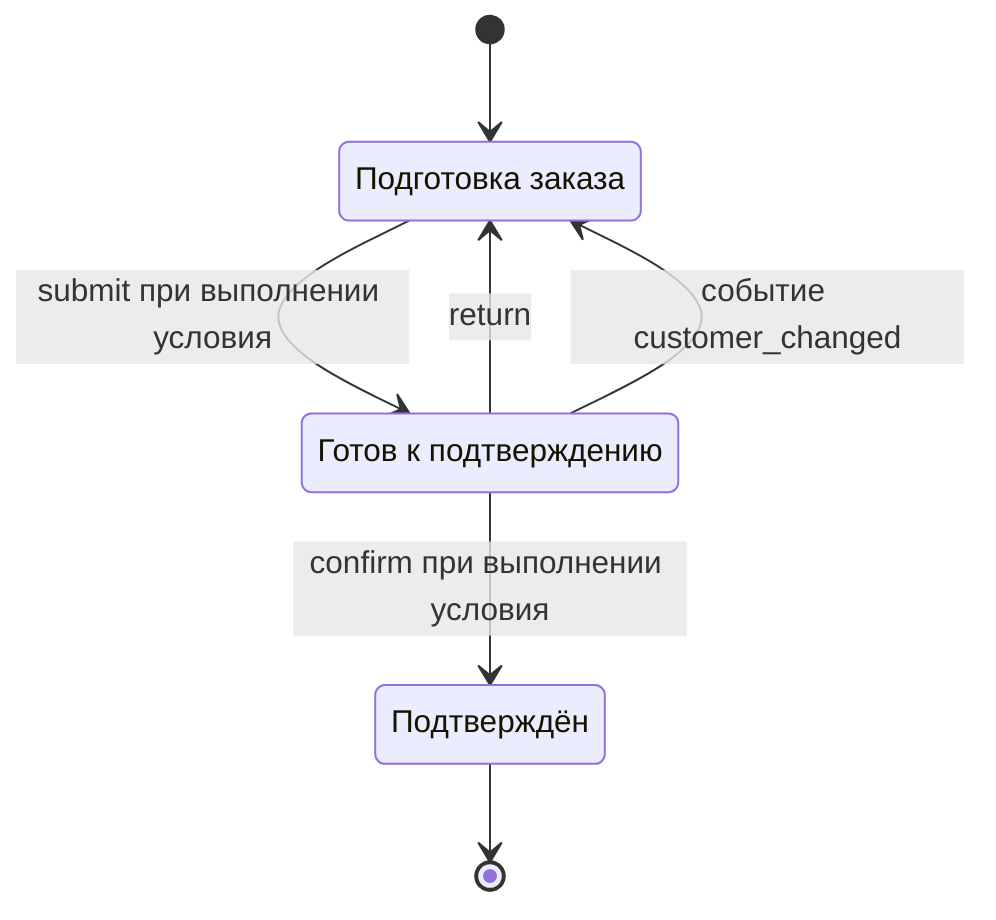
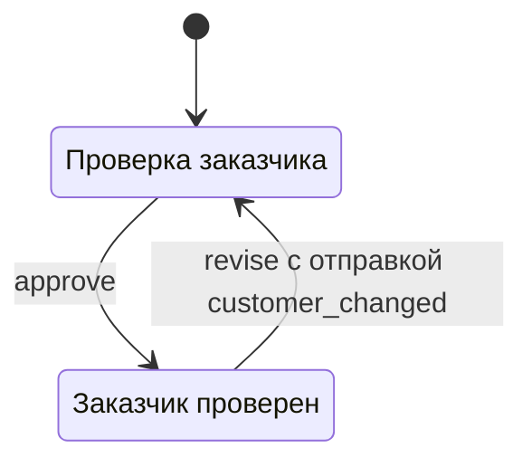
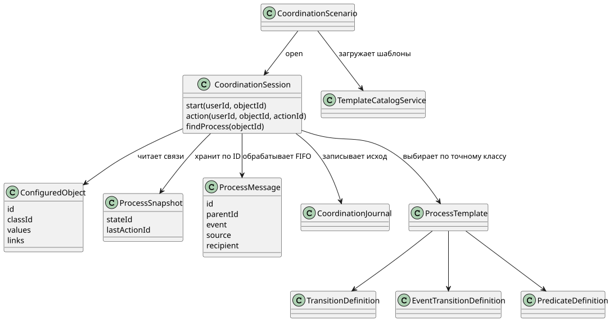
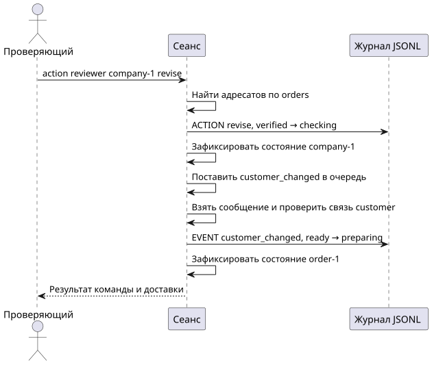
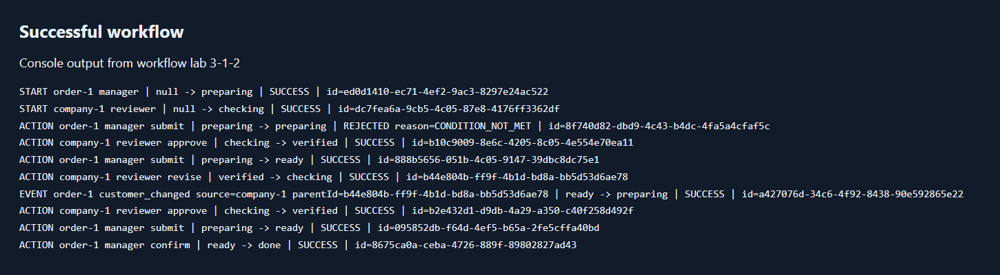
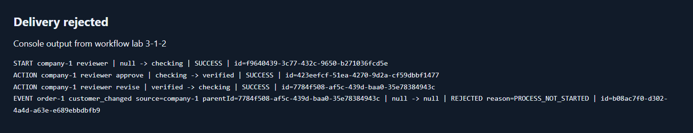

# Отчёт по лабораторной работе № 3-1-2

**Дисциплина:** «Модели объектов и процессов информационных систем»

**Тема:** «Приёмы моделирования взаимодействующих процессов»

**Предметный пример:** подготовка заказа на поставку и проверка заказчика

## 1. Цель работы

Цель работы — смоделировать согласованное поведение нескольких объектов и разработать общий механизм координации их процессов. Работа продолжает проект 3-1-1, в котором классы, роли, параметры, состояния и переходы задаются конфигурацией. Расширение добавляет два способа координации: проверку состояния и последнего успешного действия связанного процесса и автоматическую обработку сообщений от другого процесса. [Условие задания](../task_3-1-2.md), [отчёт по 3-1-1](report.md).

## 2. Объекты, участники и связи

Менеджер подготавливает заказ `order-1` с суммой 5000. Проверяющий ведёт процесс проверки фирмы `company-1`. Оба объекта подготовлены в конфигурации до запуска. Команда `start` создаёт один экземпляр процесса над указанным объектом и выбирает шаблон точного класса. Решение о проверке представлено последним успешным пользовательским действием процесса заказчика.

| Объект | Имя связи | Список ID | Назначение |
| --- | --- | --- | --- |
| `order-1` | `customer` | `[company-1]` | Проверить состояние и последнее действие заказчика. При приёме события проверить его источник. |
| `company-1` | `orders` | `[order-1]` | Выбрать получателей уведомления о повторной проверке. |

Обе связи объявляются явно. Связи хранятся у объектов, а шаблоны обращаются к их именам. Тот же шаблон заказа можно применять к объектам с другими заказчиками.

## 3. Поведение процессов



Рисунок 1 — Состояния процесса заказа.



Рисунок 2 — Состояния процесса проверки заказчика.

Для `submit` и `confirm` в ДНФ задаётся одна группа из трёх предикатов. Допустимая сумма заказа лежит в диапазоне от 1 до 100 000 включительно. По связи `customer` каждый связанный процесс должен находиться в состоянии `verified`, а его последнее успешное действие должно быть `approve`. Для обоих сравнений выбран агрегатор `all`.

После запуска состояние доступно сразу, а последнее действие ещё не задано. Для отсутствующего экземпляра или неизвестного значения проверяемого поля результат сравнения ложен для `=` и `!=`. При пустой или отсутствующей связи предикат также возвращает ложь. Отрицание, если оно задано в ДНФ, применяется к итоговому результату. После успешного `approve` менеджер повторяет ранее отклонённый `submit`.

При `revise` процесс заказчика переходит из `verified` в `checking` и порождает `customer_changed`. Получатель определяется по связи `orders` у заказчика. Заказ в состоянии `ready` проверяет, что отправитель входит в его связь `customer`, и возвращается в `preparing`. Его последнее успешное пользовательское действие остаётся `submit`.

## 4. Архитектура расширения

Консольный сеанс принимает `start` и `action`. Он читает подготовленные объекты и шаблоны из JSON, хранит снимки процессов по ID объекта и выполняет проверки ролей и условий. Пользовательские команды и внутренние сообщения имеют разные пути проверки. Для действия применяется роль пользователя. Для доставки требуется настроенный переход с допустимым отправителем и истинным условием, если оно задано.



Рисунок 3 — Добавленные классы и их связи с каталогом. [Исходник PlantUML](diagrams/coordination/classes.puml).

Перед фиксацией отправляющего перехода сеанс проверяет, что нужные связи существуют и содержат адресатов. После фиксации он помещает по одному сообщению на адресата в очередь. Все сообщения обрабатываются по порядку до следующей команды пользователя. Сообщение, возникшее при доставке, добавляется в конец очереди. Если подходящих переходов нет, сеанс записывает отказ. Если подходят несколько переходов, сеанс записывает ошибку. Состояние получателя в обоих случаях сохраняется. Уже выполненный переход источника остаётся в силе, и обработка остальных сообщений продолжается.



Рисунок 4 — Успешная доставка события о повторной проверке. [Исходник PlantUML](diagrams/coordination/event-delivery.puml).

## 5. Журнал выполнения

Журнал содержит отдельную строку JSON на каждую команду и на каждую попытку доставки. В записи указываются время, ID, тип операции, объект, состояния до и после, исход и причина неуспеха. Команда содержит ID пользователя и действие, если это `ACTION`. Запись `EVENT` содержит имя события, ID обоих объектов и `parentId` породившей команды или другого события.

| Пример записей | Объект | Состояние до → после | Исход |
| --- | --- | --- | --- |
| `ACTION revise` с ID `a1` | `company-1` | `verified → checking` | Успех |
| `EVENT customer_changed` с `parentId=a1` | `order-1` | `ready → preparing` | Успех |
| `ACTION revise` с ID `a2` в отдельном сеансе | `company-1` | `verified → checking` | Успех |
| `EVENT customer_changed` с `parentId=a2` | `order-1` | Состояния отсутствуют | Отказ. Процесс получателя не запущен. |

ID в таблице условные. Записи журнала сохраняются как доказательство выполнения. После перезапуска требуется заново выполнить `start` для подготовленных объектов. Очередь сообщений создаётся пустой.

## 6. Сценарий запуска и защиты

Запуск из каталога `lab1` на JDK 21 и Maven 3.9+.

```text
mvn -Pcoordination compile exec:java
```

| Шаг | Команда | Ожидаемый результат |
| --- | --- | --- |
| 1 | `start manager order-1` | Заказ переходит в начальное состояние `preparing`. |
| 2 | `start reviewer company-1` | Проверка находится в `checking`. |
| 3 | `action manager order-1 submit` | Отказ по условию. Заказ остаётся в `preparing`. |
| 4 | `action reviewer company-1 approve` | Заказчик переходит в `verified`. Заказ остаётся в `preparing`. |
| 5 | `action manager order-1 submit` | Повторный `submit` переводит заказ в `ready`. |
| 6 | `action reviewer company-1 revise` | Заказчик возвращается в `checking`. Событие переводит заказ в `preparing`. В журнале видны две связанные записи. |
| 7 | `action reviewer company-1 approve` | Заказчик снова переходит в `verified`. |
| 8 | `action manager order-1 submit` | Заказ снова достигает `ready`. |
| 9 | `action manager order-1 confirm` | Заказ достигает конечного состояния `done`. |

Для проверки отказа доставки в новом сеансе выполнить только `start reviewer company-1`, `action reviewer company-1 approve` и `action reviewer company-1 revise`. В конфигурации объект `order-1` существует, но процесс над ним ещё не запущен. Журнал должен показать успешный `revise` и отдельный отказ доставки.

## 7. Тестирование

Выполнено `mvn clean package` на JDK 21 и Maven 3.9.9. Прошли **398 проверок** без ошибок и пропусков, включая 19 случаев для взаимодействующих процессов. Собран `target/workflow-engine-1.0-SNAPSHOT.jar`.

| Проверка | Что подтвердить |
| --- | --- |
| Проверки связанного процесса | `submit` отклоняется до одобрения. Отдельно проверить состояние `verified` с другим последним действием. Успех требует повторной команды после `approve`. |
| Успешная доставка | После `revise` заказ переходит из `ready` в `preparing`, а `last_action` у заказа остаётся `submit`. |
| Отказ исходного действия | `revise` с пустой связью `orders` оставляет заказчика в `verified`. Записей доставки нет. |
| Отказ получателя | При незапущенном заказе источник переходит в `checking`, а доставка имеет отдельную запись с причиной. |
| Связь операции с событием | По `parentId` записи о доставке находится исходный `ACTION revise`. |
| Граничные случаи | Проверяются пустая связь в `all`, отсутствующее `last_action` для `!=`, чужой отправитель, неоднозначный переход и порядок при рассылке. |
| Совместимость | Повторно выполняется тестовый набор 3-1-1 по ролям, параметрам, условиям, переходам, истории, хранению и веб-интерфейсу. |

В основном прогоне получено 10 записей. Первый `submit` дал `CONDITION_NOT_MET` и оставил заказ в `preparing`. Повторный `submit` после `approve` перевёл заказ в `ready`. Доставка `customer_changed` вернула заказ в `preparing`, а её `parentId` совпал с ID успешной команды `revise`. Последний `confirm` завершил процесс в `done`. [Журнал основного прогона](evidence-3-1-2/success.jsonl).



Рисунок 5 — Скриншот страницы с фактическим выводом консоли. Видны отказ, повтор команды после одобрения, автоматический переход и итоговое состояние.

Во втором прогоне получено четыре записи. Команда `revise` успешно перевела заказчика в `checking`. Следующая строка содержит отдельный отказ `PROCESS_NOT_STARTED` при доставке заказу. [Журнал прогона с отказом](evidence-3-1-2/rejection.jsonl).



Рисунок 6 — Скриншот страницы с фактическим выводом консоли при отказе доставки.

## 8. Заключение

В демонстрационном примере условия согласуют момент выполнения команды с решением проверяющего, а событие возвращает подготовленный заказ на доработку по явно заданному правилу. При сдаче этот результат подтверждают два воспроизводимых сценария и журнал с исходом каждого шага.

Оформление опирается на пояснительную записку 3-1-1. Перед сдачей остаётся заполнить титульный лист актуальными данными и сверить оформление с разделом 4 задания 3-1-1. [Предыдущая записка](report.md), [план выполнения](superpowers/plans/2026-11-21-task-3-1-2.md).
