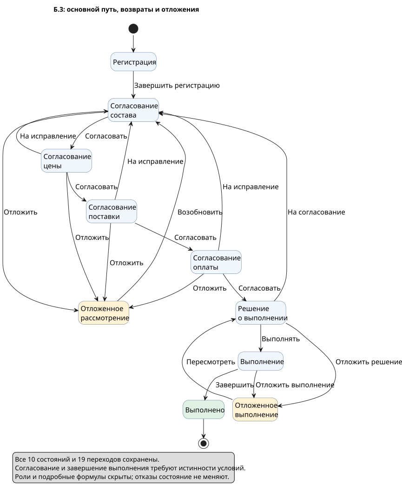
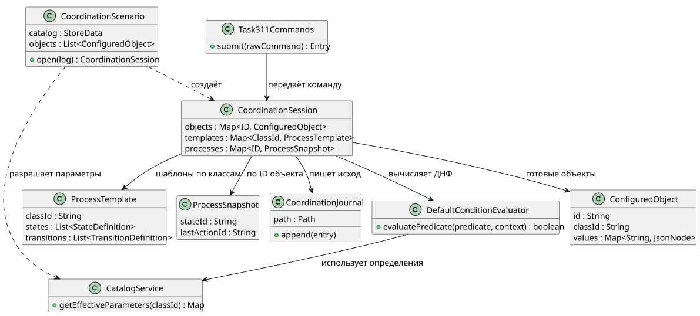
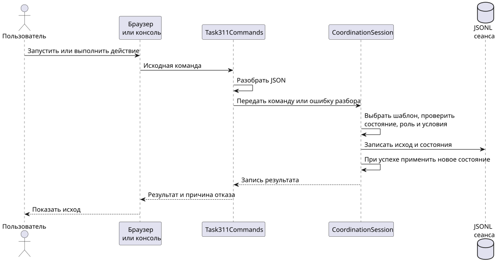
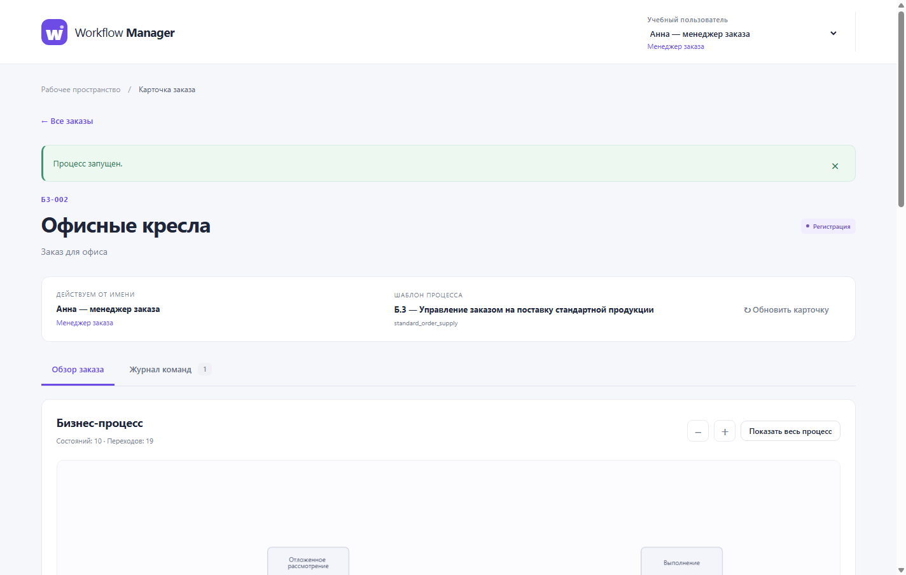
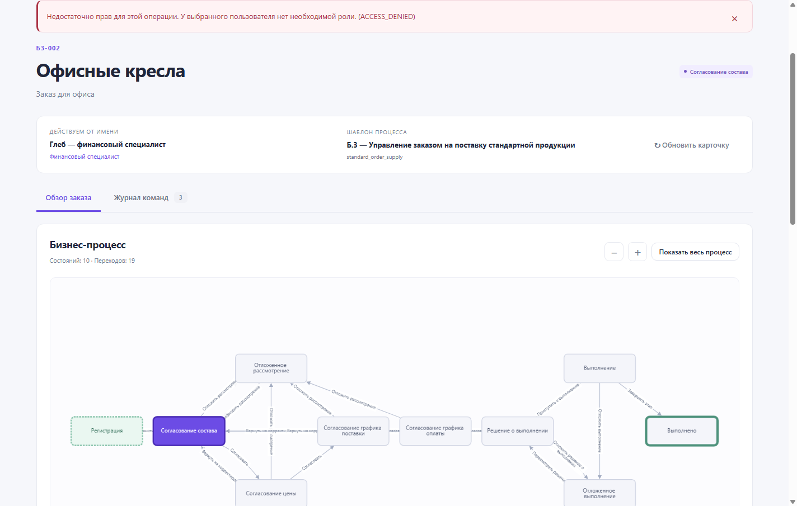
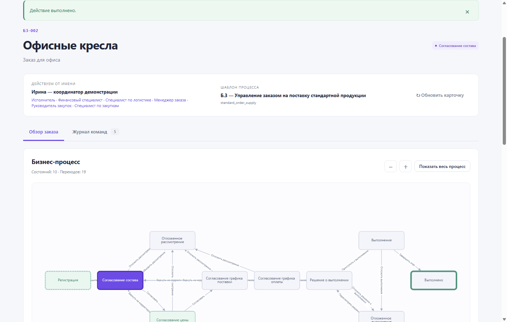
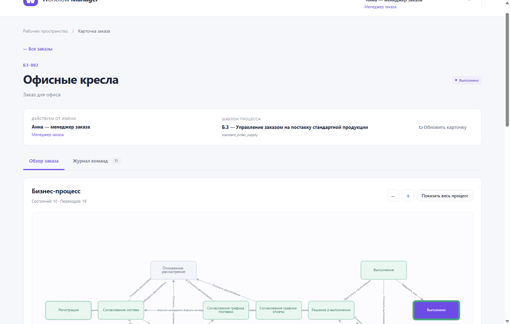
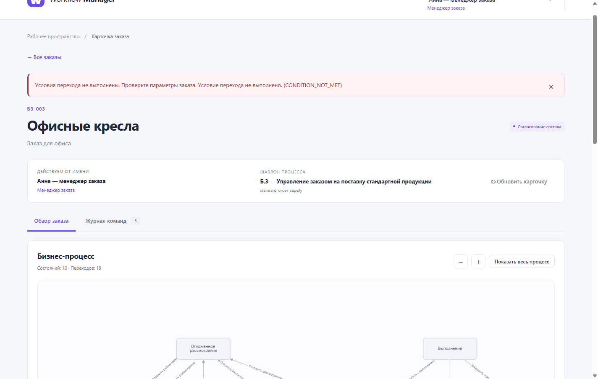
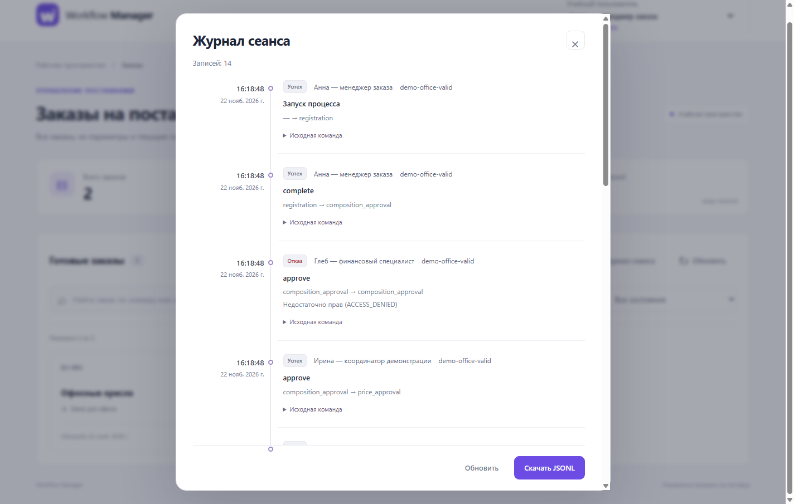

# Пояснительная записка к работе 3-1-1

**Дисциплина.** «Модели объектов и процессов информационных систем».

**Тема.** «Приёмы моделирования бизнес-логики».

**Вариант 3.** Управление заказом на поставку стандартной продукции.

| ФИО | Учебная группа |
| --- | --- |
| Панаёт Роман | 2373 |
| Крачковская Анастасия | 2374 |
| Дашкина Карина | 2374 |
| Усачев Леонид | 2374 |

## 1 Цель и задание

Цель — освоить моделирование и реализацию бизнес-логики информационных
систем с помощью исполняемых моделей объектов и процессов.

Для варианта 3 требуется описать классы объектов, параметры, готовые заказы,
пользователей, роли, состояния и переходы в конфигурации. Объекты загружаются
при запуске приложения. Пользователь отдельной командой запускает экземпляр
процесса по шаблону, непосредственно привязанному к классу заказа. Для
каждого действия проверяются состояние, роль пользователя и условие
перехода в дизъюнктивной нормальной форме (ДНФ). Каждый результат
записывается в JSONL. Текущее состояние экземпляров хранится в памяти
и сбрасывается при перезапуске. Выбранный механизм объектной модели —
наследование параметров.

## 2 Процесс и предметная модель

Основной маршрут начинается в «Регистрации». Затем исполнитель проходит
согласование состава, цены, графика поставки и графика оплаты. Руководитель
принимает решение о выполнении, исполнитель завершает заказ. Из этапов
согласования предусмотрены возвраты и отложения. Шаблон описывает 10
состояний и 19 переходов, включая основной маршрут и альтернативные ветви.



*Рисунок 1 — Диаграмма состояний варианта 3.*

**Таблица 1 — Классы и эффективные параметры.**

| Класс | Определяет или переопределяет |
| --- | --- |
| `order` | Номер, наименование продукции, количество от 1 до 10 000, сумму. |
| `standard_order` | Поставщика, срок поставки от 1 до 60 дней со значением по умолчанию 14, предоплату и причину блокировки. |
| `office_order` | Место поставки. Определение количества заменяется диапазоном от 1 до 500 с сохранением целого типа. |

Оба готовых заказа принадлежат `office_order`. Именно этому классу
назначен шаблон `standard_order_supply`. Для `demo-office-valid`
количество равно 120, предоплата — 40%, поставка занимает 14 дней по
унаследованному значению по умолчанию. При наличии поля со значением
`null` параметр остаётся незаданным. Второй заказ,
`demo-office-quantity-700`, загружается с количеством 700, поскольку
диапазон проверяется в условии перехода из согласования состава.

Роли отражают обязанности на этапах. Менеджер запускает процесс,
завершает регистрацию и согласует состав. Специалист по закупкам согласует
цену, логист — поставку, финансовый специалист — оплату. Руководитель
закупок принимает решение о выполнении, исполнитель завершает заказ.
Координатор для демонстрации объединяет роли.

На согласовании оплаты ДНФ имеет две группы. Первая требует допустимую
сумму, предоплату не более 30% и отсутствие причины блокировки. Вторая
проверяет офисный класс, допустимую сумму, предоплату не более 50% и
отсутствие причины блокировки. У заказа с 40% предоплаты первая группа
ложна, вторая истинна. Если истинны обе группы, выполняется один переход.
При незаданном параметре вычислитель возвращает ложь для самого
предиката, затем применяет заданное в конфигурации отрицание.
Числовые предикаты берут эффективный диапазон класса объекта. [Конфигурация Б.3](../src/main/resources/seed/task-3-1-1.json).

## 3 Устройство системы

Работа использует Java 21, Maven, Jackson, Javalin и браузерный интерфейс на
HTML, CSS и JavaScript. Консоль и HTTP API принимают один формат команд и
передают их в `Task311Commands`. Компонент `CoordinationScenario`
загружает шаблоны и готовые объекты, а `CatalogService` определяет
эффективные параметры по иерархии классов. `CoordinationSession` принимает
решение о запуске и переходе по шаблону точного класса.
`DefaultConditionEvaluator` вычисляет предикаты и ДНФ.



*Рисунок 2 — Основные классы исполнителя и их связи.*

Подготовленный объект хранит свой ID, класс и значения параметров. Общий
шаблон задаёт состояния, действия, роли и переходы. Состояние отдельного
экземпляра процесса хранится в снимке, связанном с ID заказа. При начале
нового сеанса карта снимков пуста. Обновление страницы читает текущую
карту на том же сервере. Перезапуск приложения создаёт новую карту и
загружает готовые заказы из конфигурации.



*Рисунок 3 — Обработка запуска или действия и возврат результата.*

Сервис последовательно обрабатывает команды в сеансе. Успешный запуск
создаёт снимок в начальном состоянии. Действие выбирает переход из текущего
состояния с учётом роли и ДНФ. Если у одного действия подходят два
разных перехода, возникает ошибка неоднозначности. Отказ и ошибка
команды сохраняют прежнее состояние. Сервис записывает результат в
журнал; успешное изменение процесса применяется после записи.
Запись включает исходную команду, пользователя, объект, предыдущий и
новый статус, исход и причину. Журнал читается для отображения и выгрузки
результатов. Каждый запуск приложения создаёт отдельный файл в
`demo/task-3-1-1/run-*/journal.jsonl`.

## 4 Демонстрация и проверки

Сервер браузерного режима запускается из `lab1` командой
`mvn -Pweb-3-1-1 compile exec:java` на `http://127.0.0.1:7071/`.
Для консоли используется `mvn -Ptask-3-1-1 compile exec:java`.
Консоль принимает команды JSON по одной на строку. В браузере исполнитель
выбирается в верхней панели. Команда запуска доступна в карточке
готового заказа. Диаграмма, состояние и журнал отображают данные
сервера.

**Таблица 2 — Проверяемые сценарии.**

| Исходные данные и команда | Ожидаемый результат | Фактический результат |
| --- | --- | --- |
| Готовый офисный заказ, менеджер, `start` | Переход от отсутствующего процесса к регистрации, `SUCCESS`. | `null → registration`, `SUCCESS`. |
| Согласование состава, финансовый специалист, `approve` | `REJECTED / ACCESS_DENIED`, этап прежний. | `ACCESS_DENIED`, оба состояния `composition_approval`. |
| Согласование цены, координатор, `correction` | Возврат к согласованию состава, `SUCCESS`. | `price_approval → composition_approval`, `SUCCESS`. |
| Офисный заказ с предоплатой 40%, последовательные `approve`, `execute`, `complete` | На оплате проходит вторая группа ДНФ, заказ достигает «Выполнено». | Все переходы успешны, конечное состояние `completed`. |
| Офисный заказ с количеством 700, согласование состава, `approve` | `REJECTED / CONDITION_NOT_MET`, этап прежний. | `CONDITION_NOT_MET`, оба состояния `composition_approval`. |
| Перезапуск с той же конфигурацией | Готовые заказы загружены, процессы не запущены, прежний журнал сохранён. | Оба заказа снова без процесса, новый журнал пуст, прежний файл сохранился. |

В браузере результат каждой команды доступен в журнале заказа. «Журнал
сеанса» содержит все записи, включая ошибки разбора команд, которые
невозможно отнести к заказу. Скачать текущий JSONL можно из интерфейса.
Последовательность показа и команды для повторения описаны в
[README](../README.md#лабораторная-работа-3-1-1-по-актуальному-заданию).

В консольном прогоне менеджер запустил `demo-office-valid` и завершил
регистрацию. Следующая строка `{oops` была зарегистрирована как
`ERROR / INVALID_COMMAND`. Исходная строка осталась в поле `command`.

В результате `mvn clean test` выполнено 407 тестов без сбоев, ошибок и
пропусков. Браузерный сценарий в Chrome выполнил 14 команд, включая два
отказа. Скрипт сравнил скачанный JSONL с записями API. После обновления
страницы состояние отображалось из действующего сеанса. После перезапуска
сервера оба заказа были готовы к запуску. [Полный JSONL браузерного прогона](evidence-3-1-1/journal.jsonl).

В следующих записях JSONL оставлены поля, по которым сверялись исходы.

```jsonl
{"actionId":"correction","before":"price_approval","after":"composition_approval","outcome":"SUCCESS","reason":null}
{"actionId":"approve","before":"composition_approval","after":"composition_approval","outcome":"REJECTED","reason":"ACCESS_DENIED"}
{"actionId":"approve","before":"composition_approval","after":"composition_approval","outcome":"REJECTED","reason":"CONDITION_NOT_MET"}
```



*Рисунок 4 — Заказ перешёл в состояние «Регистрация».*



*Рисунок 5 — Финансовый специалист получил отказ на согласовании состава.*



*Рисунок 6 — Корректировка вернула заказ с согласования цены к согласованию состава.*



*Рисунок 7 — У основного заказа достигнуто конечное состояние «Выполнено».*



*Рисунок 8 — Количество 700 превышает предел 500 у офисного заказа.*



*Рисунок 9 — Журнал показывает фактические переходы, отказы и исходные команды.*

## 5 Выводы

Объекты, роли и переходы Б.3 описаны одной конфигурацией и исполняются
общим механизмом. Наследование позволяет использовать параметры заказа
в подклассе и задать ограничение количества для офисной поставки.
Раздельное хранение исходного объекта, правила и состояния процесса
позволяет повторять сценарий в новом сеансе с теми же данными.
Журнал фиксирует решения исполнителя и объясняет отказ, а интерфейс
позволяет проследить, как команда влияет на процесс.

## Источники

1. Задание 3-1-1 «Приёмы моделирования бизнес-логики», актуальная редакция.
   Разделы 2–4, рисунок 3. Файл `task/task_3-1-1.pdf`.
2. СПбГЭТУ «ЛЭТИ». Документы для учебного процесса, раздел «Шаблоны оформления
   студенческих работ». [Сайт университета](https://new.etu.ru/ru/home/obrazovanie/dokumenty-dlya-uchebnogo-processa).
3. Репозиторий работы. [Конфигурация варианта](../src/main/resources/seed/task-3-1-1.json),
   [исполнитель](../src/main/java/ru/moipis/workflow/engine/CoordinationSession.java) и
   [тесты](../src/test/java/ru/moipis/workflow).
