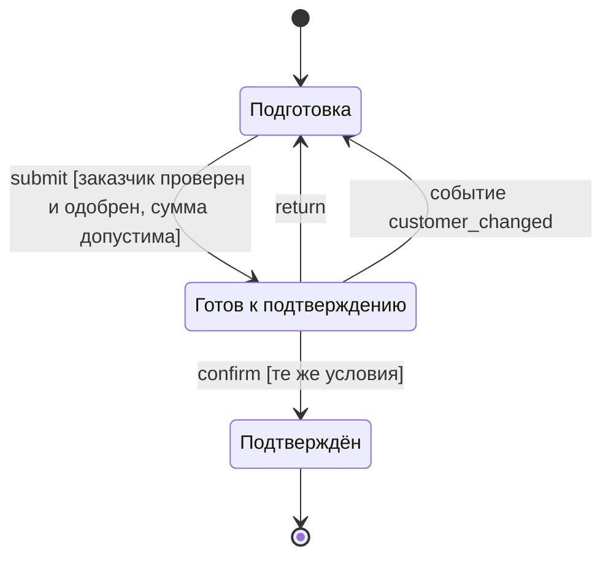
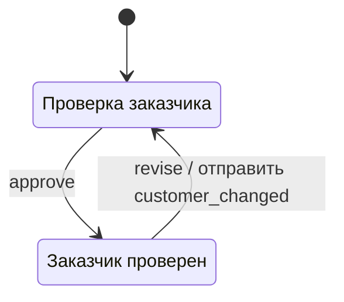

# Задание 3-1-2. Приёмы моделирования взаимодействующих процессов

Продолжение задания 3.1.1. Развивайте свой проект, сохраняя
его функциональность и разделение модели и общего механизма исполнения.

**Задание:** расширить систему описания и исполнения процессов средствами
взаимодействия: условиями по состояниям и принятым решениям связанных процессов
и передачей событий между ними. Связи, условия и правила обработки событий
должны задаваться конфигурацией.

**Цель работы:** освоить моделирование согласованного поведения нескольких
объектов и разработать общий механизм координации их процессов.

## 1. Что сохраняется и что добавляется

Общие требования, правила обработки команд, проверки ролей и параметров,
ДНФ, журналирование и требования к отчёту — из 3.1.1.
Наследование параметров и составность по-прежнему можно реализовать по отдельности
или совместно; выбор одного механизма не ограничивает оценку.

Теперь вместо одного независимого процесса нужно показать **как минимум два
взаимодействующих экземпляра**. Число шаблонов определяется классами объектов;
шаблон, как и раньше, привязан к точному классу.
Обязательны **оба** новых механизма:

1. **Согласование через условие:** действие одного процесса разрешено только
   при требуемом состоянии и принятом решении связанного процесса.
2. **Взаимодействие через событие:** успешный переход источника порождает
   сообщение, по которому получатель выполняет настроенный переход.

Объекты и связи между ними можно заранее задать в конфигурации. СУБД
не обязательна; достаточно памяти и JSON/JSONL-лога. После перезапуска процессы
и недоставленные события не восстанавливаются. Многопоточность, внешний брокер,
таймеры, редактор связей и отдельные операторы разветвления/слияния не требуются.

## 2. Функциональные требования

### Связи объектов

**Именованная связь** — запись у конкретного объекта: «имя связи → список
идентификаторов связанных объектов». Например, у заказа связь «заказчик»
указывает на объект фирмы, а у фирмы связь «заказы» — на её заказы.

- В списке хранятся идентификаторы готовых объектов. По идентификатору объекта
  система находит запущенный над ним процесс. Как и в 3.1.1, над одним объектом
  существует не более одного экземпляра процесса; запускается он командой `start`.
- Связи направленные: ссылка от заказа к заказчику **не создаёт обратную ссылку**.
  Если нужны оба направления, каждое задаётся явно.
- Связи задаются у объектов, а в шаблонах используются их имена. Поэтому один
  шаблон может работать с заказами разных заказчиков. Эти связи нужны при любом
  выборе объектной модели — наследовании, составности или их сочетании.

### Условия по связанным процессам

- В условии можно проверить **текущее состояние** и **последнее успешное действие
  пользователя** связанного процесса. В этой работе принятое решение представлено
  идентификатором последнего успешного действия, например `approve`. После запуска
  оно не задано; каждое успешное пользовательское действие заменяет его.
  Отказ, ошибка и обработка события его не меняют.
- Для сравнений достаточно `=` и `!=`. Проверка выполняется отдельно для каждого
  объекта по связи. Если его процесс не запущен, результат проверки ложен.
  Если процесс запущен, но действий ещё не было, ложна проверка последнего
  действия; состояние уже можно проверять. Это правило действует и для `!=`.
- Результаты объединяются агрегатором: `all` — проверку прошли все процессы
  по связи, `any` — хотя бы один. Агрегатор указывается в конфигурации предиката,
  даже для одного связанного объекта. Достаточно реализовать один из них
  как заменяемую стратегию по правилам 3.1.1.
  Если связь отсутствует или её список пуст, весь предикат ложен, в том числе
  с `all`. Отрицание `not` применяется к итоговому результату.
- Новые предикаты входят в ту же ДНФ, что и проверки параметров. Если условие
  перехода ложно, команда отклоняется без изменения процесса. После изменения
  связанного процесса пользователь **повторяет команду**: автоматического
  ожидания и повторного исполнения нет.

### События

- **Событие** — внутреннее сообщение о выполненном переходе. В конфигурации
  перехода задаются имя события и имя связи с получателями. Система берёт
  список из этой связи у объекта-источника и **после успешного перехода**
  создаёт отдельное сообщение каждому объекту из списка.
  Сообщение содержит имя события и идентификаторы источника и получателя.
- Если переход предусматривает отправку, но указанная связь отсутствует
  или пуста, исходный переход отклоняется: состояние не меняется, событий нет.
  Если же объект-получатель указан, но его процесс не запущен, исходный переход
  может выполниться; отказ возникает уже при доставке.
- В шаблоне получателя задаётся переход по событию: исходное состояние,
  имя события, имя связи с допустимыми отправителями, целевое состояние
  и необязательное условие. Система проверяет, входит ли идентификатор отправителя
  в эту связь **у получателя**. Затем вычисляет условие относительно объекта
  получателя. Ровно один подходящий переход выполняется; отсутствие подходящего —
  отказ, несколько — ошибка. При отказе или ошибке получатель не меняется.
- Пользовательские действия проверяют роли по правилам 3.1.1. Автоматический
  переход разрешён только настроенным обработчиком события от допустимого
  источника; он не выполняется от имени пользователя. События создаёт сам сервис;
  внешний ввод принимает только команды `start` и `action`.
- Доставляйте сообщения в порядке создания: после завершения исходного шага
  и до следующей пользовательской команды. Достаточно одной очереди в памяти
  и последовательной обработки. Если получатель порождает новое событие,
  оно добавляется в конец очереди. Демонстрационная цепочка должна завершаться.
- Отказ или ошибка обработки события не отменяет выполненный переход источника
  и не препятствует доставке другим получателям. Не запущен процесс, нет
  подходящего обработчика или процесс завершён — отказ с записью в лог.
  Отклонённые и ошибочные шаги новых событий не порождают.
  Повторной доставки в рамках задания нет.

### Результаты и лог

Все требования к логу из 3.1.1 сохраняются. Дополнительно записывайте **каждую
попытку обработки события**, в том числе отказ и ошибку: имя события, источник,
получателя, состояние до/после, результат и причину неуспеха.
Запись должна отличаться от пользовательской команды и позволять найти
породившую её команду или событие, например по идентификатору.
Успех источника и отказ получателя — две разные записи, а не общий отказ.

## 3. Пример: подготовка заказа и проверка заказчика

Менеджер ведёт заказ, проверяющий — процесс заказчика. Все данные подготовлены
заранее; действие «Назначить повторную проверку» меняет состояние процесса,
а не редактирует объект.





### Как задать связи

Ниже — фрагменты конфигурации; остальные поля оформляются как в 3.1.1.
Для класса `order` задайте числовой параметр `amount` с диапазоном от 1 до
100 000 включительно. Имена новых полей можно выбрать свои.
Здесь `links` хранит связи отдельно от значений параметров `values`:

```yaml
objects:
  - id: order-1
    class: order
    values:
      designation: ЗК-001
      amount: 5000
    links:
      customer: [company-1]
  - id: company-1
    class: company
    values:
      name: Заказчик № 1
    links:
      orders: [order-1]
```

Эту запись следует читать так:

- У заказа `order-1` связь `customer` («заказчик») содержит `[company-1]`.
  Значит, для проверки заказчика нужно найти процесс над объектом `company-1`.
- У фирмы `company-1` связь `orders` («заказы») содержит `[order-1]`.
  По ней процесс фирмы отправляет событие процессу заказа.

`customer` и `orders` — выбранные нами имена связей; `company-1` и `order-1` —
идентификаторы объектов. Обе связи заданы явно и независимо друг от друга.
Объявлять их как параметры классов не нужно.

### Как проверить связанный процесс

В предикате шаблона заказа `process: customer` означает: взять связь `customer`
**у текущего заказа** и проверить процессы объектов из её списка.
Для `order-1` это процесс `company-1`. `field` выбирает проверяемое поле,
а `value` — идентификатор требуемого состояния или действия:

```yaml
predicates:
  - id: amount_valid
    parameter: amount
    operator: in_range
  - id: customer_verified
    process: customer
    field: state
    operator: '='
    value: verified
    aggregate: all
  - id: customer_approved
    process: customer
    field: last_action
    operator: '='
    value: approve
    aggregate: all
```

Здесь `all` применяется к одному процессу. Условие ниже читается:
«сумма заказа в допустимом диапазоне, заказчик находится в `verified`,
его последнее успешное действие — `approve`».
Во втором переходе показана реакция заказа на событие:

```yaml
transitions:
  - from: preparing
    action: submit
    to: ready
    condition:
      - [amount_valid, customer_verified, customer_approved]
  - from: ready
    on_event: customer_changed
    source: customer
    to: preparing
```

### Как отправить и принять событие

В шаблоне заказчика действие `revise` назначает повторную проверку.
Блок `emit` задаёт отправку события:

```yaml
transitions:
  - from: verified
    action: revise
    to: checking
    emit:
      - event: customer_changed
        to: orders
```

Пусть заказ находится в `ready`, а заказчик — в `verified`. Тогда:

1. Проверяющий выполняет `revise` для `company-1`. Система находит
   `links.orders` этого объекта: `[order-1]`.
2. Процесс `company-1` переходит в `checking`. В очередь помещается
   `customer_changed` с источником `company-1` и получателем `order-1`.
3. У заказа в состоянии `ready` есть переход `on_event: customer_changed`.
   Его `source: customer` требует проверить `links.customer` **заказа**:
   там есть `company-1`, поэтому отправитель разрешён. Заказ переходит в
   `preparing` без команды менеджера.

Таким образом, `to: orders` внутри `emit` выбирает адресатов у отправителя,
а `source: customer` проверяет отправителя у адресата. Обычное поле `to`
самого перехода (`ready`, `checking`, `preparing`) обозначает целевое состояние.

**Что должно получиться:**

1. Запустите оба процесса. Пока заказчик в `checking`, команда `submit` заказа
   отклоняется.
2. Выполните `approve` у заказчика. Заказ остаётся в `preparing`:
   для перехода в `ready` менеджер повторяет `submit`.
3. Выполните `revise` у заказчика. Событие `customer_changed` автоматически
   возвращает заказ из `ready` в `preparing`; это явно настроенная реакция,
   а не автоматическое повторение отклонённой команды.
4. Снова выполните `approve`, затем `submit` и `confirm` заказа.
   В логе видны пользовательские команды и отдельная обработка события.

## 4. Варианты и результаты

Выберите и согласуйте с преподавателем небольшой пример:

- **Приём заявки на разработку изделия:** заявка и проверка фирмы-заказчика;
  при желании добавьте процессы коммерческого предложения и технического задания.
- **Подготовка заказа на поставку:** заказ и проверка заказчика, как выше;
  при желании добавьте процессы позиций и разрешения поставки изделий.
- **Свой пример** с двумя или несколькими взаимодействующими процессами.

Представьте код, конфигурацию, готовые объекты, инструкцию запуска и тесты.
Сохраните обязательные проверки 3.1.1 и дополнительно проверьте:

1. Проверки состояния и последнего успешного действия связанного процесса:
   отказ зависимого перехода при невыполненном условии, затем успех после
   изменения связанного процесса и повторной команды.
2. Порождение события успешным переходом и изменение процесса получателя.
3. Отсутствие событий при отказе исходного действия.
4. Отказ доставки, например незапущенному получателю: источник не откатывается,
   причина есть в логе.
5. Возможность по логу проследить команду и порождённое ею событие.

Отчёт и его оформление — по разделу 4 задания 3.1.1. В описании процесса
покажите связи участников и условия взаимодействия, в диаграммах классов —
добавленные части системы, в тестировании — новые сценарии и пояснённые скриншоты.
Копировать весь прежний отчёт не нужно.
На защите достаточно двух процессов, условия с проверками состояния и последнего
действия связанного процесса и одного событийного перехода с просмотром лога.
